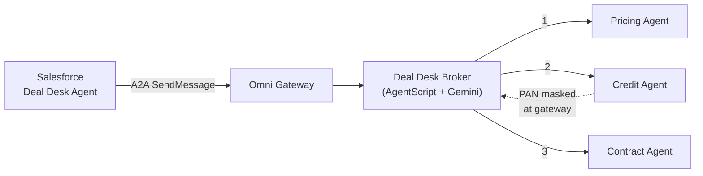

# deal-desk-network

**MuleSoft Agent Fabric** agent network for the **Deal Desk** demo.

A sales rep asks "can deal X get Y% discount?". The **Deal Desk Broker** checks the request with three specialist A2A agents and returns one decision: Approved, VP Approval Required or Not Allowed.



| Repo | Layer |
|---|---|
| [deal-desk-salesforce](https://github.com/deepshikhalmp-dot/deal-desk-salesforce) | Agentforce agent and Apex action that call this broker |
| **deal-desk-network** (this repo) | Agent network, broker and governance policy |
| [deal-desk-agents](https://github.com/deepshikhalmp-dot/deal-desk-agents) | The Pricing, Credit and Contract agents (Node.js, on Render) |

## What's in here

| File | Purpose |
|---|---|
| [`agent-network.yaml`](agent-network.yaml) | Network definition: the agent registry, the LLM, connections, policies and the broker |
| [`brokers/deal-desk-broker.agent`](brokers/deal-desk-broker.agent) | The broker logic in AgentScript (dialect `AGENTFABRIC=1.5`) |
| [`exchange.json`](exchange.json) | Exchange asset descriptor (`deal-desk-network`) and the deploy-time variables |

### Registry

The network registers three A2A v0.3 agents hosted at `https://deal-desk-agents.onrender.com/{pricing,credit,contract}`. The LLM is **Gemini 3.5 Flash Lite**, called directly through the Gemini API.

### Broker flow

The `deal_desk_broker` works in three stages:

1. **Orchestrator `dealReview`.** The LLM reads the request and finds the deal ID and discount %. It then calls the agents in this order, each at most once:
   1. **Pricing** returns `APPROVED`, `VP APPROVAL REQUIRED` or `NOT ALLOWED`.
   2. **Credit** returns the risk and either standard or secured terms. The broker copies this reply word for word.
   3. **Contract** is called only if pricing did not say Not Allowed. It returns a draft ID such as `CTR-ACME-Q4-20`.
2. **Router `decisionRouter`.** The final decision is chosen by deterministic routing on the pricing outcome, not by the LLM's wording. The hard policy stays out of the prompt.
3. **Echo responses.** The broker replies with a single text that starts with `DEAL DESK DECISION: APPROVED`, `… VP APPROVAL REQUIRED` or `… NOT ALLOWED`. If no deal ID was given, it asks for one instead.

The Salesforce Apex callout parses this prefix and the `CTR-…` ID.

### Governance: PAN masking

The `pan-masking` policy is a DataWeave body transformation on the **Credit Agent connection**. On every response it masks Indian PAN numbers (`AAAAA9999A` → `AAAAA****A`). This happens at the gateway, before the broker or the LLM sees the data. The mock Credit Agent returns PANs in clear text on purpose, to show the policy working.

## Deploy-time variables

| Variable | Default | Secret |
|---|---|---|
| `pricingAgent.url` / `creditAgent.url` / `contractAgent.url` | Render URLs | No |
| `gemini.url` | `https://generativelanguage.googleapis.com` | No |
| `gemini.apiKey` | *(empty)* | **Yes.** Enter it at deploy time; never commit it |

## Build and deploy

Open the folder in Anypoint Code Builder with the Agent Fabric extension and deploy the network to an Omni Gateway. Build output (`target/`) and local deployment state (`.deployment/`) are git-ignored.

The deployed broker is exposed through the shared gateway at `…/deal_desk_broker/`. Salesforce calls this URL (see the remote site setting in [deal-desk-salesforce](https://github.com/deepshikhalmp-dot/deal-desk-salesforce)). The endpoint is not authenticated, so treat it as a demo-only deployment.

### Try it

```bash
curl -s -X POST "$BROKER_URL" \
  -H 'Content-Type: application/json' -H 'A2A-Version: 1.0' \
  -d '{"jsonrpc":"2.0","id":"1","method":"SendMessage",
       "params":{"message":{"messageId":"m1","role":"ROLE_USER",
       "parts":[{"text":"Review deal ACME-Q4 with 10% discount"}]}}}'
```

The reply contains `DEAL DESK DECISION: APPROVED (ACME-Q4, 10% discount) …` and the contract draft `CTR-ACME-Q4-10`. The PAN in the reply is masked as `AAACA****F`.
